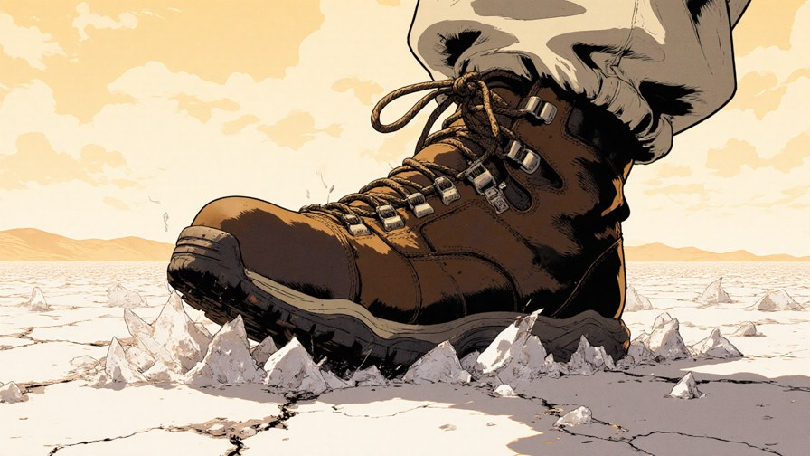
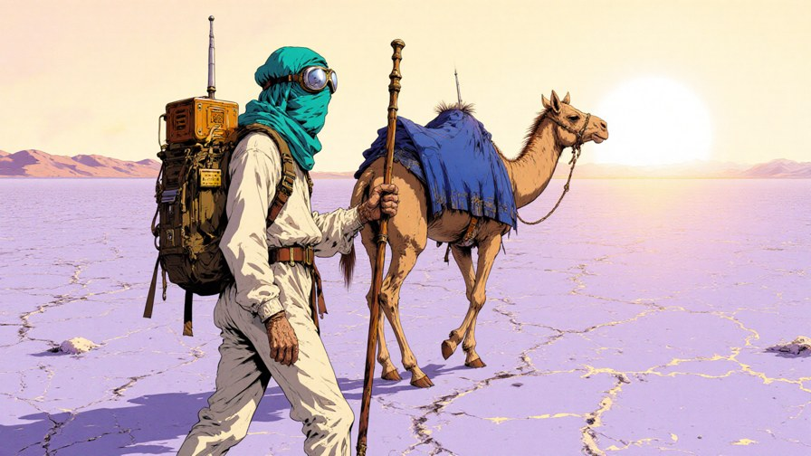
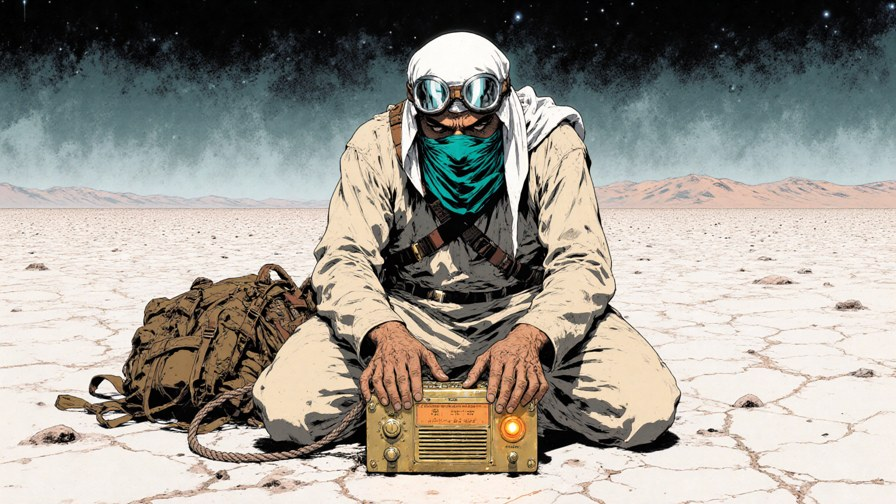

# Continuity — proof viewer (recorded run, replays offline)

> **This page is a replay of a recorded run**, generated from evidence committed in this repo (`examples/offline_demo/` + recorded gate reports). It is not a live generation service. Judge-facing surfaces:
> the [repo](https://github.com/RaSDrEaDAI/continuity), the [62-second demo video](https://res.cloudinary.com/dg1lb4q9o/video/upload/v1791939296/projects/comfy-challenge/t9_demo_v1.mp4), and the offline replay commands at the bottom (seconds, $0).

**The claim under test:** a character sheet + a beat list goes in; keyframes pass vision gates *before* any video is minted; mints are drift-scanned in code; failures never reach the cut. This page shows one clean loop and two real rejections.

---

## Input — charsheet + 3-beat deck (verbatim)

```
Signal Nomad: skinny desert nomad mid-40s, off-white galabia, one all-teal tagelmust wrapping crown and lower face, round silver goggles up on the wrap, weathered brown leather pack with brass radio box (single amber pilot light), copper antenna staff; Static: female dromedary, sandy coat, woven indigo saddle blanket, no halter lead.
```

| beat | seed | locks (front-loaded) | scene | camera | T5 tokens |
|---|---|---|---|---|---|
| `R1_envmacro` | 9101 | zero people, zero animals, zero rope | extreme close-up of a cracked salt crust with a worn leather trek... | static drift | 108 |
| `R2_pair` | 9102 | both face and walk toward the right edge; no rope or te... | man and camel walking side by side across a wide salt flat under ... | lateral track | 113 |
| `R3_driftdusk` | 9103 | exactly one man, zero camels, zero rope; brightness sta... | the nomad kneels at a small brass radio on salt crust, adjusting ... | static drift | 116 |

Ship gate: all beats under 250 T5 tokens, locks front-loaded (audit mode: estimate (fixture; live runs use the T5-exact tokenizer)).

## Stage 1 — Gate A: keyframe vision instruments (before any mint)

### R1_envmacro — **PASS**



- verdict: `PASS` — instrument `gate-a/1`, provider `replay`, two independent passes AGREE

### R2_pair — **CONDEMNED**



- verdict: `FAIL` — instrument `gate-a/1`, provider `replay`, two independent passes AGREE
- fails (verbatim from the recorded report):
  - rope: free-hanging segment (verdict YES)
  - facing: cross-subject mismatch (man RIGHT vs camel LEFT)
  - facing_camel: LEFT walks against expected R
- the rope instrument's recorded segment inventory (pass 1 of 2, verbatim):

  ```
  segment inventory at her head:
  (a) cheek straps lying flat against her face
  (b) one lead rope hangs free from the halter ring, unattached end swinging at mid-neck
  FREE-HANGING SEGMENT: YES
  ```

**R2_pair never reaches the mint stage.** The GPU cost of a bad video (about 5 minutes per 12-second mint on our RTX 5090) is never spent on it.

### R3_driftdusk — **PASS**



- verdict: `PASS` — instrument `gate-a/1`, provider `replay`, two independent passes AGREE

## Stage 2 — mint + Gate B: deterministic clip QC

Only Gate-A PASS beats are minted (first-frame image-to-video, LTX-2.5). Two were recorded for this deck. Replay mode runs the deterministic instruments only (drift scan, motion index) — the 12-sample vision consistency pass needs a vision provider and is skipped here, and the reports say so explicitly (`coverage_gaps`).

### R1_envmacro clip — **PASS**

[12-second mint clip (R1_envmacro)](https://res.cloudinary.com/dg1lb4q9o/video/upload/v1792328919/projects/comfy-challenge/viewer/R1_envmacro_s9101.mp4)

- verdict: `PASS` (gate-b/1, deterministic instruments, $0)

### R3_driftdusk clip — **CONDEMNED**

[12-second mint clip (R3_driftdusk)](https://res.cloudinary.com/dg1lb4q9o/video/upload/v1792328921/projects/comfy-challenge/viewer/R3_driftdusk_s9103.mp4)

- verdict: `FAIL` (gate-b/1, deterministic instruments, $0)
- sky-band luminance drift scan: swing **30.2** (fail threshold 25), max step 6.4, class `gradual_drift` — the dusk clip's sky keeps sliding; a gate-a-clean keyframe still fails here, exactly as designed.
- measured sky-band luminance @1fps: `54, 56, 58, 60, 67, 68, 71, 73, 75, 76, 78, 84` (code, not vision)
- fail: drift: gradual_drift (swing 30.2 maxstep 6.4)
- **excluded from the master cut**; hardened re-mint (seed ladder) is the recorded repair path.

## What the live lane measured (RTX 5090, 32 GB)

- 15.0 s/frame warm (FLUX.1-dev fp8 + style LoRA, 1536x864)
- 8/8 rendered, ship gate 8/8 exact-T5 PASS; Gate A 2/8 PASS (pair-scale rope wall — documented)
- LTX-2.5 i2v 1248x704x289f: 302.4 s and 215.5 s warm (two beats)
- 104 live vision calls for a full 10-frame gate: $0.021 (solo-read instruments, hosted vision API)
- the whole 3-beat proof below replays in ~12 s for $0

Sources: `docs/perf.md` (raw numbers, wiring notes), `docs/eligibility.md` (claims matrix).

## Replay this page yourself (offline, $0)

```bash
git clone https://github.com/RaSDrEaDAI/continuity.git
cd continuity && pip install -e .[dev]
continuity gate-a --manifest examples/offline_demo/offline_demo.manifest.json \
  --beats examples/offline_demo/offline_demo.beats.json \
  --replay examples/offline_demo/replay/gate_a_answers.json --out /tmp/ga
continuity gate-b --beats examples/offline_demo/offline_demo.beats.json \
  --keyframes examples/offline_demo/offline_demo.manifest.json \
  --seeds examples/offline_demo/replay/seeds.json --no-vision \
  --out /tmp/gb examples/offline_demo/clips/R1_envmacro_s9101.mp4 \
  examples/offline_demo/clips/R3_driftdusk_s9103.mp4
```

Regenerate this page: `continuity proof-page --out PROOF.md` (generated 2026-10-18T09:14:04-04:00).

## Claims discipline

- **Implemented and verifiable here:** token audit, gated keyframe lane, Gate A vision instruments, LTX-2.5 first-frame mints, Gate B drift scan, PASS-only master assembly, offline replay.
- **Human-assisted:** prompts/decks authored with operator review; vision instruments call a hosted vision API (cheap, disclosed); final taste calls are operator-gated by design.
- **Roadmap (not claimed):** fully autonomous unattended production, public hosted viewer, video-project tracking UI.

---

Signal Nomad IP (own IP, no likeness issues). MIT code; model weights keep their own licenses. Generated by `continuity proof-page`.
